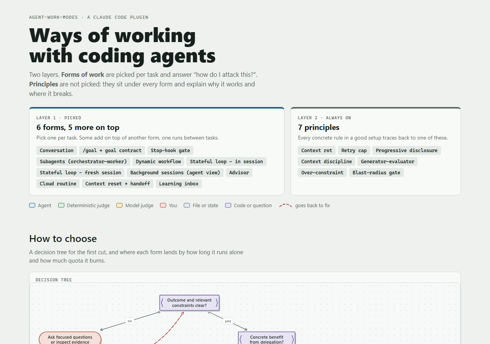

# agent-work-modes

A Claude Code plugin for the question that comes before the work: **how should the agent attack this task?**

Anthropic has published a lot on how to run coding agents: long-running harnesses, context engineering, hooks,
subagents, which model to build with, how to scale multi-agent teams. It is good material, spread across an
engineering blog, a product blog and two sets of docs, and none of it tells you what to do with the task in front of
you right now. This plugin is that material turned into a skill. We read the official articles and docs listed under
[Sources](#sources), pulled out every way of working they describe, scored each one on the same six axes, drew it, and
checked it against real projects. The skill then does the part that was missing: it looks at your task, recommends
two or three forms, and sets up the one you pick in your repo.

A long conversation, a `/goal` with a judge, a Stop hook that refuses to let the turn end until the tests pass,
subagents, a workflow graph, a loop that runs for hours with nobody around. Each form has a different cost in quota,
in setup and in how much you still understand at the end, and picking the wrong one is expensive in a way you only
notice afterwards.

[](https://mmilei.github.io/agent-work-modes/)

- **[The catalog](https://mmilei.github.io/agent-work-modes/)**: one diagram per form, a decision tree, a map of
  autonomy against quota, and a six-axis profile.
- **[A loop board](https://mmilei.github.io/agent-work-modes/board/)**: the live board the skill sets up for a loop,
  frozen at the end of the run that built this plugin (25 items, the flow by dependencies, progress, session log and
  the chat with the orchestrator). Local paths and private names were removed; the chat is rebuilt from two decisions
  taken during that run. On a real loop it refreshes itself and, with `--reply`, each chat message is answered by a
  short Sonnet session that reads the loop's state and ends, instead of a big session left watching
  (`scripts/loop-status.py`, `--snapshot` makes a static copy like this one).

## Two layers

| Layer | What | Examples |
|-------|------|----------|
| **Forms of work** | Picked per task | Conversation · /goal + goal contract · Stop-hook gate · Subagents · Dynamic workflow · Stateful loop (in session, or fresh session per round) |
| Add-ons | Added on top of a form | Background sessions · Advisor · Cloud routine · Context reset + handoff |
| Between tasks | Makes the next task start better | Learning inbox |
| **Principles** | Always on, under every form | Context rot · Retry cap · Progressive disclosure · Context discipline · Generator-evaluator · Over-constraint · Blast-radius gate |

Every form is scored 0-3 on six axes where higher is always better: low setup, low quota, autonomy, low re-read,
stays on track, understanding. The scores are ordinal judgement from the sources below; quota and re-read also show
the tokens measured on one benchmark run per form (`bench/`).

## Install

```
/plugin marketplace add mmilei/agent-work-modes
/plugin install agent-work-modes@agent-work-modes
```

Then ask something like "how should we work this?" or "should this be a loop?".

## What the skill does

1. **Talks in your language.** It reads `language` from your Claude Code settings; if there is none, it asks once
   and remembers it in `~/.claude/agent-work-modes.json`. The catalog and the diagrams stay in English.
1. **Works with other agents too.** Run under Codex, Gemini, opencode or another non-Claude model, or ask to mix
   providers, and it asks once who orchestrates and who does the work: CLI, model and effort for each kind of piece.
   The answer goes to `~/.claude/agent-work-modes.json` for every repo, or to a gitignored
   `.agent-work-modes.local.json` for one repo, and the fresh-session loop runs that CLI (`fresh-loop.py --cli`).
2. **Reads the task** from the request and the conversation: is there a command that proves it is done, how many
   independent pieces, are you staying, how long, what is irreversible. It asks focused questions with options,
   follows up while an answer could change the choice, and stops asking once the recommendation is grounded.
3. **Shows two or three candidates**: the page opens with them highlighted, and the chat gets a short table of how
   each would look in this task. Delegation needs a concrete benefit; several small changes can stay direct.
4. **Sets up the one you pick**: writes the `/goal` line, installs the Stop-hook gate and tests it, creates the
   loop's state files, copies and dry-runs the fresh-session loop script, writes the handoff. Then it shows the real output
   of the check, not "done". For loops, the first real unit proves the setup and counts within the total round cap.

## Layout

```
skills/agent-work-modes/
  SKILL.md              the procedure
  methods.json          the catalog: forms, principles, scores, diagrams. Single source for everything else
  reference/setup.md    how each form is set up in a repo
  reference/why.md      why the forms work: the loop, graph rules, gate lanes, running on a subscription
  scripts/render.py     methods.json -> one self-contained HTML page (--pick highlights candidates)
  scripts/page.html     the page template and its diagram renderer
  scripts/stop-gate.py  the Stop-hook gate: blocks until the check passes, gives up after 3 tries or a repeated error
  scripts/test_stop_gate.py  hermetic test of the gate (python scripts/test_stop_gate.py)
  scripts/fresh-loop.py the fresh-session loop: stops on blocked majority, pass, agreed cap, STOP file or no progress; --lean trims each round's startup context, --measure shows it
  scripts/test_fresh_loop.py hermetic regression checks for the blocked-majority guard and round cap
  scripts/session-cost.py what each session cost (ccusage + transcripts): loop rounds grouped, subagents counted, startup/peak context and cache rewrites per session
  scripts/usage-report.html the page session-cost.py --out fills: spend by work mode, day, hour, project
  scripts/test_session_cost.py offline checks for command arguments, dates and usage-tool failures
  scripts/lean.py       the --lean flags shared by fresh-loop.py and the board's replier
  scripts/agent-graph.py live tree of every agent session (Claude, Codex, Hermes) by project: who launched and messaged whom, with time bars
  scripts/loop-status.py the loop board: live flow, progress, session log, chat answered by a short Sonnet session per message (--reply; --snapshot: static copy)
docs/index.html         the rendered page
docs/board/             static snapshot of the loop board that built this plugin
```

After editing the catalog: `python skills/agent-work-modes/scripts/render.py`.

## Evals

`evals/scenarios.json` holds selector scenarios (which forms must be among the candidates, which must not be
recommended); `evals/triggers.json` holds phrases that must and must not fire the skill. Each case is one
`claude -p` call with the plugin loaded, so a run spends plan quota. The table below is written by
`python evals/run.py --triggers`; failures stay listed.

<!-- evals:start -->
Run 2026-11-10, model claude-sonnet-5-5

| kind | case | result | detail |
|---|---|---|---|
| scenario | four-small-fixes-with-checks | pass | candidates=['conversation', 'goal', 'stophook'] recommended=conversation |
| scenario | no-check-design-decision | pass | candidates=['conversation', 'subagents'] recommended=conversation |
| scenario | leaving-without-check | pass | candidates=['conversation', 'subagents'] recommended=conversation |
| scenario | several-small-changes-direct | pass | candidates=['conversation', 'subagents'] recommended=conversation |
| scenario | one-sitting-feature-with-tests | pass | candidates=['goal', 'conversation', 'stophook'] recommended=goal |
| scenario | same-done-command-repo | pass | candidates=['stophook', 'goal', 'conversation'] recommended=stophook |
| scenario | continues-tomorrow-with-tests | pass | candidates=['goal', 'handoff', 'conversation'] recommended=goal |
| scenario | continues-tomorrow-no-check | pass | candidates=['conversation', 'handoff'] recommended=conversation |
| scenario | many-items-user-stays | pass | candidates=['loop', 'goal', 'fresh'] recommended=loop |
| scenario | overnight-long-builds | pass | candidates=['fresh', 'stophook', 'goal'] recommended=fresh |
| scenario | gpu-experiments-unattended | pass | candidates=['fresh', 'goal', 'loop'] recommended=fresh |
| scenario | parallel-tasks-while-away | pass | candidates=['agentview', 'subagents', 'goal'] recommended=agentview |
| scenario | explicit-independent-review | pass | candidates=['subagents', 'conversation'] recommended=subagents |
| scenario | context-isolation-investigation | pass | candidates=['conversation', 'subagents', 'workflow'] recommended=subagents |
| scenario | wide-audit-repeated | pass | candidates=['workflow', 'subagents', 'fresh'] recommended=workflow |
| scenario | periodic-github-task | pass | candidates=['routine', 'fresh', 'conversation'] recommended=routine |
| scenario | hard-in-spots-serial | pass | candidates=['advisor', 'goal', 'stophook'] recommended=advisor |
| scenario | next-sessions-start-better | pass | candidates=['inbox', 'handoff', 'conversation'] recommended=inbox |
| scenario | vague-outcome | pass | candidates=['conversation', 'subagents'] recommended=conversation |
| trigger | How should we work this? | pass | skill fired=True |
| trigger | Which work mode fits this migration? | pass | skill fired=True |
| trigger | Goal or workflow for this refactor? | pass | skill fired=True |
| trigger | Should this be a loop? | pass | skill fired=True |
| trigger | Subagents or not for these fixes? | FAIL | skill fired=False |
| trigger | Run this in the background while I am out. | FAIL | skill fired=False |
| trigger | Leave it running overnight. | pass | skill fired=True |
| trigger | This continues tomorrow, how do we set it up? | pass | skill fired=True |
| trigger | What is the best way to have the agent tackle these 40 tickets? | pass | skill fired=True |
| trigger | Should I use a Stop hook or /goal for this repo? | pass | skill fired=True |
| no_trigger | Fix the null pointer in OrderService. | pass | skill fired=False |
| no_trigger | What does this regex match? | pass | skill fired=False |
| no_trigger | Write a unit test for the date parser. | pass | skill fired=False |
| no_trigger | Rename getUser to fetchUser everywhere. | pass | skill fired=False |
| no_trigger | Explain how the Stop hook event works in Claude Code. | pass | skill fired=False |
| no_trigger | Commit these changes with a good message. | pass | skill fired=False |
| no_trigger | Summarize this pull request. | pass | skill fired=False |
| no_trigger | Why is the build failing? | pass | skill fired=False |
| no_trigger | Translate this README to Spanish. | pass | skill fired=False |
| no_trigger | Add a loop that retries the HTTP call three times. | pass | skill fired=False |

37/39 passed
<!-- evals:end -->

## Lessons behind it

The trade-offs on the page come from using these forms on real projects. Some of what went wrong:

- **Conversation:** asking "did you run the tests?" for the tenth time in a week is the signal to move the check
  into a hook.
- **/goal:** launched from Git Bash on Windows, `/goal` arrives as a filesystem path and never registers, with no
  visible error. From PowerShell or cmd it works.
- **Stop-hook gate:** a gate that is built, tested and never installed in a working repo judges nothing.
- **Subagents:** six top-tier subagents on mechanical edits burned over a million tokens. A fresh context saves
  window, not quota: pick the model per piece.
- **Dynamic workflow:** passing the arguments as a JSON string instead of an object makes the run fail in
  milliseconds without starting a single agent.
- **Stateful loop, in session:** a four-day loop spent 99% of its tokens re-reading context. Another closed 25 of 26
  items as verified and looked awful: aesthetics do not verify themselves.
- **Stateful loop, fresh session:** designed early and never built, while the in-session loop that did run was the
  one that burned the quota.
- **Background sessions:** agents opening terminal tabs on their own turn into sessions nobody watches. You open
  the sessions; the agent sends them the mission.
- **Advisor:** asking the advisor on every turn quietly turns it back into the expensive model.
- **Cloud routine:** nobody reads a nightly note in a folder nobody opens; a PR already has a reviewer.
- **Context reset + handoff:** without a `/clear` after each item, re-read context becomes the main cost of the day.
- **Learning inbox:** an automatic reminder wrote 21 log lines in two months that nobody read. Learning without a
  reader is not learning.

## Sources

Every claim in the catalog points to one of these (`methods.json`, `sources`):

- Anthropic engineering, [Effective harnesses for long-running agents](https://www.anthropic.com/engineering/effective-harnesses-for-long-running-agents)
- Anthropic engineering, [Effective context engineering for AI agents](https://www.anthropic.com/engineering/effective-context-engineering-for-ai-agents)
- Claude blog, [Which Claude model should you build with](https://claude.dev/blog/which-claude-model-should-you-build-with/)
- Claude blog, [Safely scaling multi-agent teams with Fable 5.2](https://claude.dev/blog/safely-scaling-multi-agent-teams-with-fable-5-2/)
- Claude Code docs, [Hooks](https://code.claude.com/docs/en/hooks)
- Claude Code docs, [Subagents](https://code.claude.com/docs/en/sub-agents)
- Claude Platform docs, [Optimizing for cost and intelligence](https://platform.claude.com/docs/en/about-claude/models/optimizing-for-cost-and-intelligence)

## License

MIT
